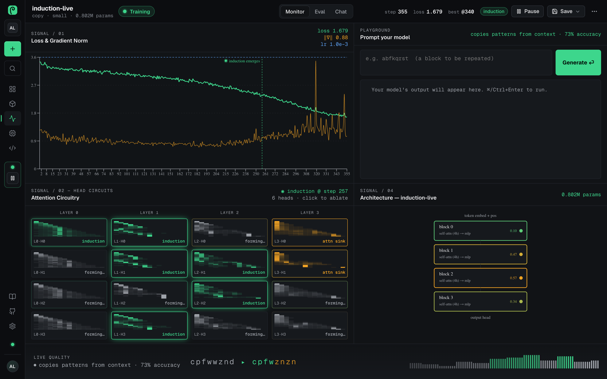
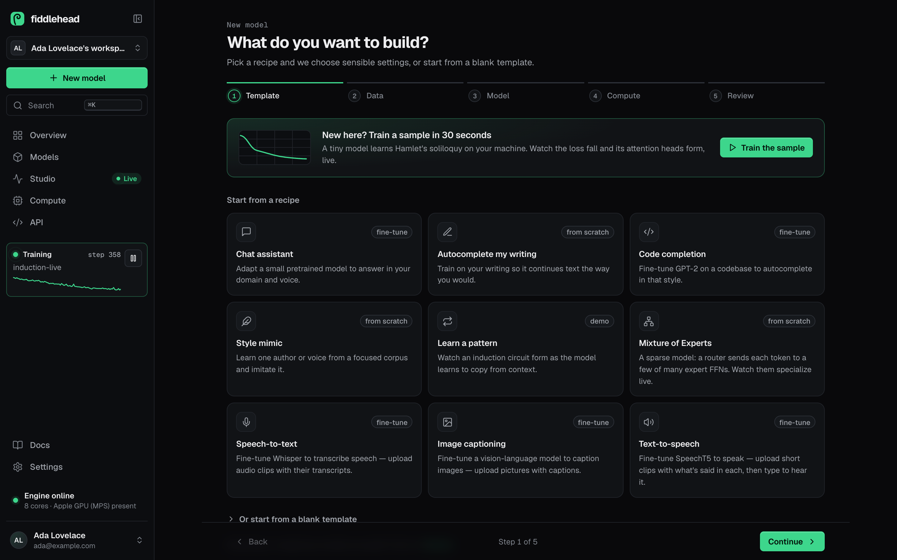
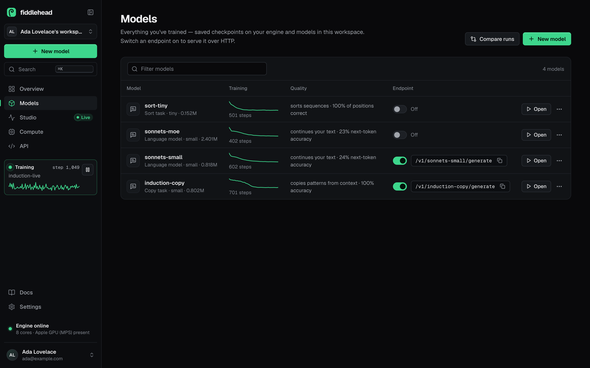
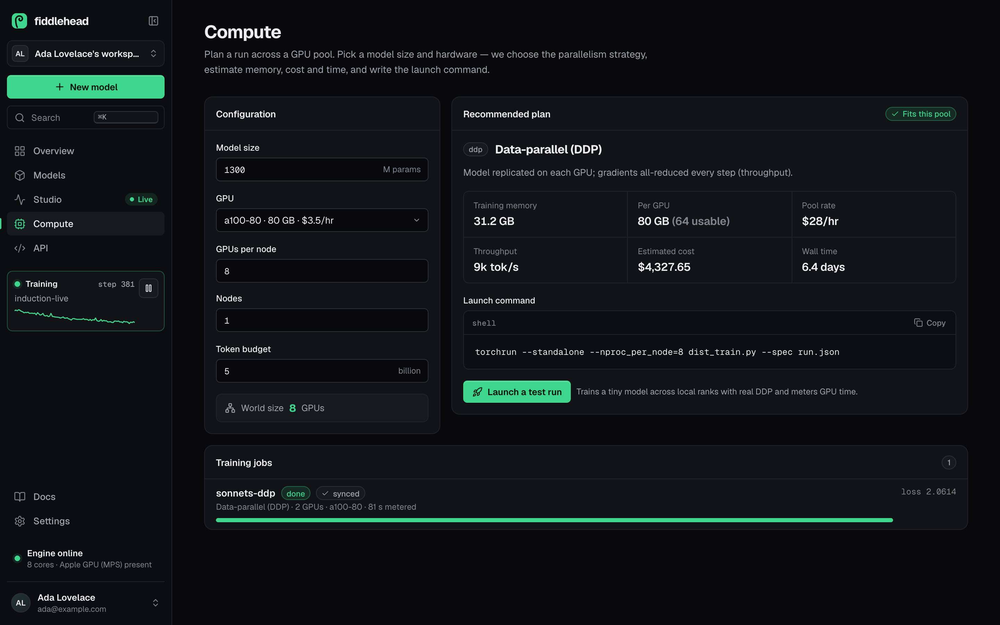
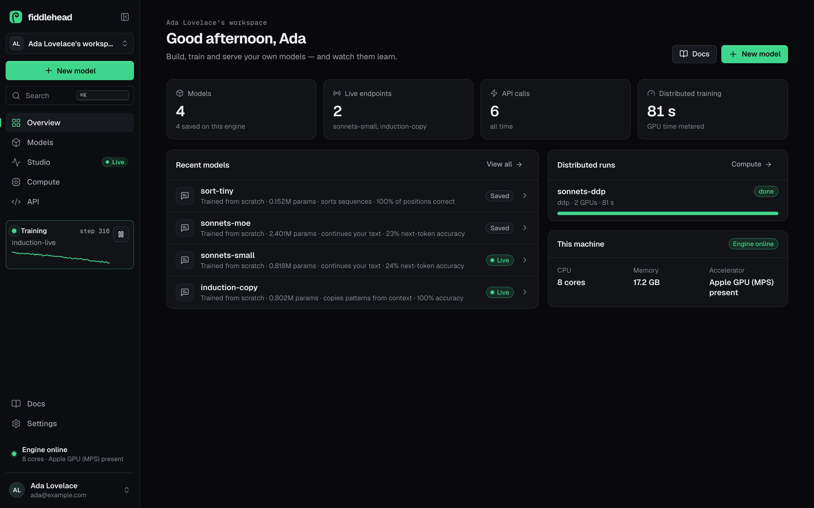
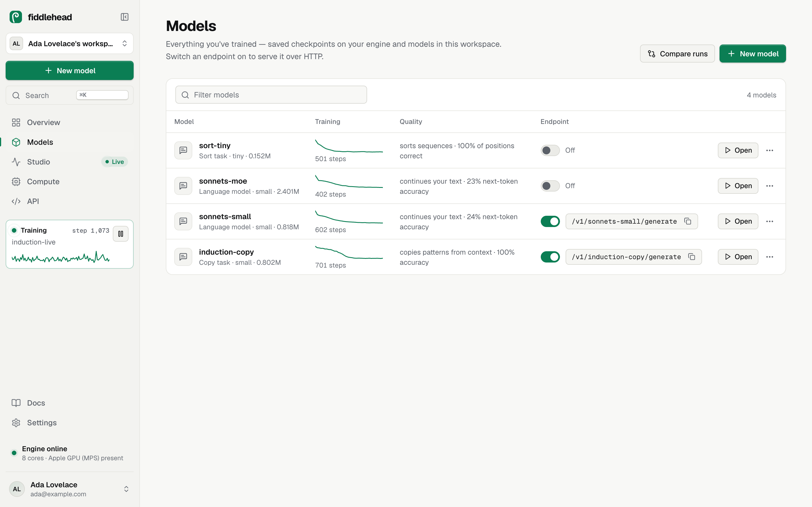
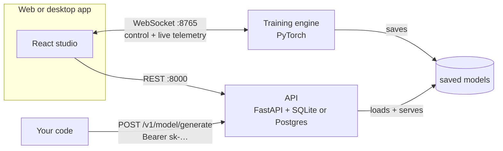
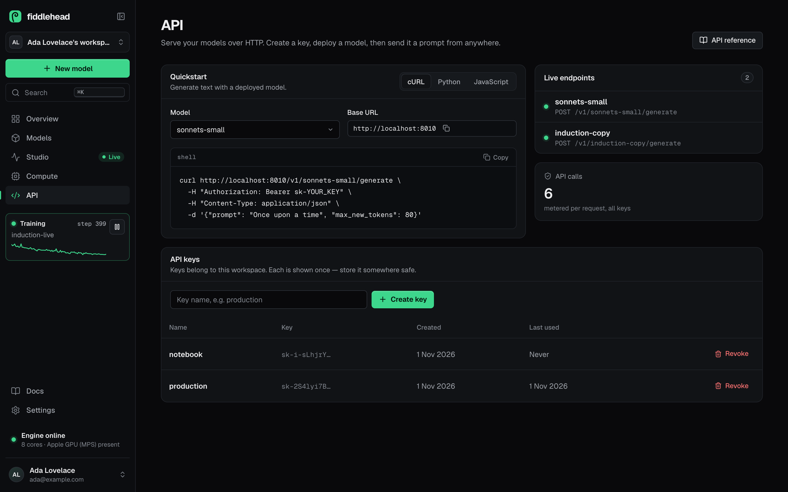

<p align="center">
  
</p>

<p align="center">
  <b>An open-source studio for training, fine-tuning and serving your own small AI models —<br>
  with a live view inside the network while it learns.</b>
</p>

<p align="center">
  <a href="https://github.com/aniketshukla1/fiddlehead/actions/workflows/ci.yml"></a>
  <a href="LICENSE"></a>
  
  
  
  <a href="CONTRIBUTING.md"></a>
</p>

<p align="center">
  <a href="#quickstart">Quickstart</a> ·
  <a href="#what-you-get">Features</a> ·
  <a href="#how-it-works">How it works</a> ·
  <a href="#serve-a-model-as-an-api">API</a> ·
  <a href="#configuration">Configuration</a> ·
  <a href="CONTRIBUTING.md">Contributing</a>
</p>

<p align="center">
  
  <br>
  <sub>▶ <a href="docs/media/fiddlehead-launch.mp4">Watch it with sound (23 s, MP4)</a> — the training run, head labels and API reply in it are real.</sub>
</p>

---

Most training tools hand you a progress bar and a loss number. **Fiddlehead shows you what the model is learning
while it learns** — the loss and gradients streaming in, every attention head drawn and labelled by the behaviour it
picks up, induction circuits lighting up the moment in-context learning appears. Then one switch turns the model
into an HTTP API.

It runs on your laptop — no GPU required — and scales out to your own GPUs when you need it. The name comes from
the young fern frond: a tight spiral of random weights that slowly unfurls into something that understands.

**Build things like:** autocomplete in your own writing style · code completion for your codebase · a domain
assistant fine-tuned from SmolLM or Qwen · speech recognition tuned to your accent · a custom voice · an image
captioner — small, focused models you own.

## Quickstart

You need **Python 3.10+** and **Node 18+**. No GPU needed: training runs on the CPU, and uses an NVIDIA GPU
automatically when there is one.

```bash
git clone https://github.com/aniketshukla1/fiddlehead.git
cd fiddlehead
python3 -m venv .venv && source .venv/bin/activate   # recommended
make setup                                            # Python + Node dependencies
make dev                                              # engine + API + app → http://localhost:5173
```

Open **http://localhost:5173**, create a local account, and click **Train the sample**. A tiny model starts
learning Hamlet's soliloquy on your machine; within a minute the loss is falling and you can watch its attention
heads specialise.

Fine-tuning open models, speech, image captioning and PDF import use optional packages. Install them when you
want those recipes:

```bash
pip install transformers peft accelerate soundfile librosa sentencepiece pillow pymupdf
```

<details>
<summary><b>Without make</b> — three terminals</summary>

```bash
# 1 · the training engine (PyTorch, WebSocket on :8765)
cd backend && pip install -r requirements.txt && python engine.py

# 2 · the API: accounts, models, keys, hosted inference (FastAPI on :8000)
cd backend && uvicorn api.app:app --port 8000

# 3 · the web app (Vite on :5173)
cd frontend && npm install && npm run dev
```

Port 8000 taken? Run the API elsewhere and point the app at it: `API_PORT=8010 make dev`, or
`VITE_API_URL=http://localhost:8010 npm run dev`.
</details>

## What you get

### See inside the network



The studio is a live instrument panel for one training run:

- **Loss & gradient norm** stream every step, with the learning rate and a marker where a capability emerges.
- **Attention circuitry** draws every head, labelled by what it's learning — previous-token, positional,
  attention sink — and **induction heads light up** when in-context learning forms. Click a head to switch it
  off and watch the quality move: a live causal experiment.
- **Playground, Eval and Chat** let you prompt the model mid-training, run an eval suite as it learns, or hold a
  streaming conversation with temperature, top-p, top-k and a system prompt.
- **Mixture of Experts** runs get an Experts view showing how the router spreads tokens across experts.
- **Checkpoints**: keep the best evaluation, roll back to it, or rewind training to any saved step.

### Recipes for text, code, speech and vision



| Start from | What it trains |
|---|---|
| **Autocomplete my writing · Style mimic** | A transformer from scratch on your text, sized in plain words (Tiny 0.15M → XL 85M params) |
| **Chat assistant · Code completion** | LoRA or full fine-tunes of open models: GPT-2, DistilGPT-2, SmolLM, Pythia, Qwen2.5, TinyLlama |
| **Speech-to-text** | Whisper, adapted to your audio and transcripts |
| **Text-to-speech** | SpeechT5 with a HiFi-GAN vocoder, adapted to a voice |
| **Image captioning** | A ViT-GPT2 captioner, adapted to your images |
| **Learn a pattern · Sort sequences** | Synthetic copy and sort tasks where circuits form visibly — the quickest way to see how transformers learn |
| **Mixture of Experts** | A sparse model with a router across 4 or 8 experts |

Bring data the way you have it: paste text, drop in files and PDFs, point at a folder or URL, crawl a site, or
read from S3, GCS, Google Drive or Dropbox. Text is cleaned and split into training and validation by document,
so validation text never leaks into training.

**Production training knobs**, behind an *Advanced* panel with tuned defaults: warmup with cosine, linear or
constant schedules (previewed as you type), gradient accumulation, fp32 / bf16 / fp16 mixed precision, gradient
clipping, weight decay, label smoothing, dropout, early stopping, checkpoint intervals, seeds, character or
byte-level BPE tokenizers, and LoRA rank, alpha and dropout.

### Models, endpoints and keys



Every saved model shows its own training curve and quality. **Flip the endpoint switch and it's served over
HTTP**; create an API key on the API page and call it from anywhere. Download any model as a `.zip` (weights,
tokenizer, metadata), compare runs side by side, or export a model card.

### Scale past one GPU



Give the planner a model size and a GPU pool: it picks **single GPU, data-parallel (DDP), sharded (FSDP) or
tensor + pipeline parallel**, estimates training memory, throughput, cost and wall time, and writes the `torchrun`
command. *Launch a test run* trains for real across local ranks with PyTorch DDP, checks every rank ends with
identical weights, and meters the GPU time.

### Accounts that hold up

Sign-up and sign-in (plus Google and GitHub when configured), two-factor authentication with recovery codes,
signed-in devices you can revoke, an audit log, and workspaces with members, roles and invitations. Self-hosted
installs have no plans or credit limits; those appear only when billing is configured.

<p align="center">
  
  
</p>

## How it works



Fiddlehead is three small processes:

- **The training engine** (`backend/engine.py`) builds, trains and samples models, and streams telemetry frames
  — loss, gradients, the full attention map with head labels, samples, evaluations — to any connected app over one
  WebSocket. It runs wherever the compute is: your laptop, or a GPU box you connect to by URL from the wizard.
- **The API** (`backend/api/`) owns accounts, workspaces, the model registry, API keys and hosted inference.
- **The app** (`frontend/`) is a React studio that runs in the browser or as a native desktop app (Tauri).

The engine protocol is plain JSON: the app sends `create`, `start`, `pause`, `save`, `load`, `generate`,
`ablate`, `rewind` and friends; the engine answers with `meta`, `status`, per-step frames and streamed samples. Any
process that speaks it can be a training target.

## Serve a model as an API



Save a model in the studio, switch its endpoint on in **Models**, create a key on the **API** page, then:

```bash
curl http://localhost:8000/v1/my-model/generate \
  -H "Authorization: Bearer sk-YOUR_KEY" \
  -H "Content-Type: application/json" \
  -d '{"prompt": "Once upon a time", "max_new_tokens": 80, "temperature": 0.8}'
```

```json
{ "model": "my-model", "prompt": "Once upon a time", "text": "…", "latency_ms": 128 }
```

Parameters: `prompt`, `max_new_tokens`, `temperature`, `top_k`, `top_p`. The full reference — errors, rate limits,
Python and JavaScript examples — is built into the app under **Docs**. Hosted endpoints serve text models today;
speech and vision models are trained, saved and exported the same way.

Prefer no API server at all? Any saved model runs standalone:

```bash
cd backend && python serve.py my-model --port 8770
```

## Configuration

Everything has a working default. For a real deployment, copy `backend/.env.example` to `backend/.env` and run
`python backend/check_config.py` to see what's on.

| Variable | Default | What it does |
|---|---|---|
| `JWT_SECRET` | generated on first run | Signs sessions. Generated once into `backend/.jwt_secret`; set it when running several API processes |
| `DATABASE_URL` | `sqlite:///./fiddlehead.db` | Any SQLAlchemy URL, e.g. Postgres |
| `FIDDLEHEAD_SAVE_DIR` | `backend/saved` | Where saved models live — the engine, `serve.py` and the API share it |
| `FIDDLEHEAD_DATASETS_DIR` | `backend/datasets` | Where reusable datasets are stored |
| `APP_URL` · `CORS_ORIGINS` | `http://localhost:5173` · local dev origins | The app's address (for links in emails and OAuth returns), and the origins allowed to call the API |
| `SMTP_HOST` … `EMAIL_FROM` | unset — links are logged | Outgoing mail for email confirmation and invites |
| `GOOGLE_CLIENT_ID/SECRET` · `GITHUB_CLIENT_ID/SECRET` | unset — buttons hidden | Social sign-in; a provider appears once both values are set |
| `STRIPE_*` | unset — no plans or credit limits | Paid plans and credits, for hosted deployments only |
| `VITE_API_URL` | `http://localhost:8000` | Where the app finds the API |
| `VITE_GITHUB_URL` | this repository | GitHub links in the app; set to an empty string to hide them |

## Desktop app

The same app runs as a native window through [Tauri](https://tauri.app) and starts the engine for you:

```bash
make desktop        # needs a Rust toolchain
```

Point it at a specific Python or backend folder with `FIDDLEHEAD_PYTHON=/path/to/python` and
`FIDDLEHEAD_BACKEND=/path/to/backend`. `cd frontend && npm run tauri build` produces installers (`.dmg`, `.msi`,
`.deb`, `.AppImage`).

## Project layout

```text
fiddlehead/
├── backend/
│   ├── engine.py · server.py      training engine and its WebSocket protocol
│   ├── model.py · hooks.py        the transformer, and the telemetry that labels attention heads
│   ├── finetune.py · asr.py · tts.py · vlm.py     fine-tuning text, speech and vision models
│   ├── sources.py · tokenizer.py · dataset.py     gathering data, tokenizers, leak-free splits
│   ├── dist_train.py              multi-GPU training with PyTorch DDP
│   ├── serve.py                   serve one saved model over HTTP
│   ├── api/                       accounts, workspaces, models, keys, inference, jobs (FastAPI)
│   └── tests/
├── frontend/
│   ├── src/components/            pages, the studio and its instrument panels
│   ├── src/ui.css                 the design system
│   └── src-tauri/                 the desktop shell
├── scripts/dev.sh · Makefile      one-command development
└── docs/media/                    screenshots and the launch video
```

## Bring your own model

The telemetry layer doesn't assume a model family. `hooks.TelemetryHooks` attaches to any PyTorch transformer
whose attention modules keep their softmax weights in `last_attn_weights` (`[batch, heads, seq, seq]`) — a
one-line addition to most implementations:

```python
from hooks import TelemetryHooks

telem = TelemetryHooks(model)   # finds the attention modules itself
...
loss.backward()
frame = telem.collect(step=step, loss=loss.item(), lr=lr, tokens=token_strs)
```

Each frame holds what the studio draws: attention maps with head labels, per-layer gradient norms and an
embedding projection. `engine.py` shows the whole loop.

## Honest limits

Models you train on a laptop in minutes are **small**. They're genuinely useful on focused data — your writing, a
codebase, product names, an accent — and excellent for understanding how these models learn, but they aren't a
replacement for frontier chat models. Larger base models and the bigger sizes want a GPU; run the engine on one and
connect to it from the wizard.

## Roadmap

- One-command Docker image for the engine and API
- Hosted inference for speech and vision models
- Dataset versioning and eval suites you can share between runs
- More open base models and adapters out of the box

Ideas and pull requests are welcome — see [CONTRIBUTING.md](CONTRIBUTING.md).

## Contributing

```bash
make check          # web build, backend compile, tests — the same checks CI runs
```

Read [CONTRIBUTING.md](CONTRIBUTING.md) for the layout and conventions, and [SECURITY.md](SECURITY.md) for reporting
vulnerabilities privately.

## License

[MIT](LICENSE). Built on [PyTorch](https://pytorch.org), [Hugging Face Transformers](https://github.com/huggingface/transformers)
and [PEFT](https://github.com/huggingface/peft), [FastAPI](https://fastapi.tiangolo.com), [React](https://react.dev),
[Vite](https://vitejs.dev), [Tauri](https://tauri.app), [Lucide](https://lucide.dev) icons and the
[Geist](https://vercel.com/font) typeface.
